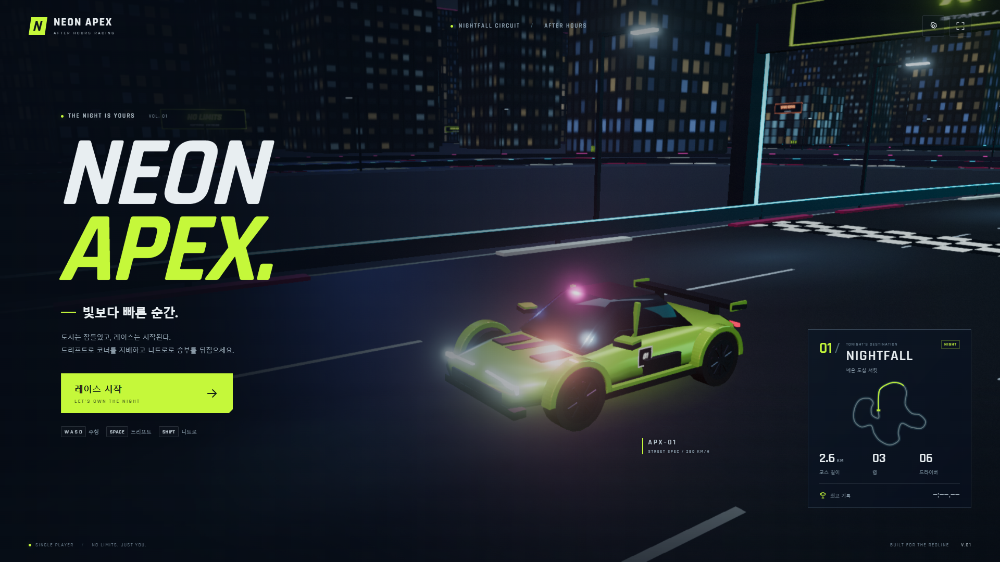

# NEON APEX

네온 도심에서 5대의 AI와 3랩을 경쟁하는 PC 브라우저용 3D 아케이드 레이싱 게임입니다. 차량과 도시, 조명, 도로, 사운드를 프로젝트 안에서 생성하며 실행 중 외부 CDN이나 게임 자산 서버에 의존하지 않습니다.

**[브라우저에서 바로 플레이](https://majeongsu72-jpg.github.io/neon-apex/)** · [GitHub 소스코드](https://github.com/majeongsu72-jpg/neon-apex)

PC의 Chrome·Edge에서 플레이할 수 있습니다. 방향키 또는 WASD로 주행하고, Space로 드리프트, Shift로 니트로를 사용하세요.



## 실행

Node.js 24 환경을 권장합니다. 이 프로젝트는 Windows의 Node.js 24.16.0에서 검증했습니다.

처음 소스를 다운로드할 때는 `git clone https://github.com/majeongsu72-jpg/neon-apex.git`을 실행하고 `cd neon-apex`로 프로젝트 폴더에 들어가세요.

```powershell
npm ci
npm run dev
```

브라우저에서 `http://127.0.0.1:5173/`을 여세요. Chrome 또는 Edge와 그래픽 가속 / WebGL2 지원이 필요합니다. 다운로드와 설치는 프로젝트 준비 단계에만 필요하며 게임은 브라우저에서 플레이합니다.

완성 빌드를 실행하려면 다음 명령을 사용하세요.

```powershell
npm run build
npm run preview
```

프로덕션 미리보기 주소는 `http://127.0.0.1:49173/`입니다. 다른 로컬 프로젝트의 캐시와 겹치지 않도록 게임 전용 포트를 사용합니다. `dist/`에 생성된 파일은 정적 웹 서버에서도 실행할 수 있습니다. `index.html`을 파일 탐색기에서 직접 열기보다 웹 서버로 실행해주세요.

## 플레이

| 키 | 동작 |
| --- | --- |
| W / ↑ | 가속 |
| S / ↓ | 브레이크 |
| A, D / ←, → | 조향 |
| Space + 조향 | 드리프트 |
| Shift + 가속 | 니트로 |
| Esc | 일시정지 / 계속 |
| R | 마지막으로 통과한 체크포인트에 복귀 |
| Enter | 시작 화면 / 조작 안내 / 결과에서 다음 단계 |
| F3 | 프레임과 렌더링 진단 표시 |

코너의 화살표를 확인하고 진입 전에 감속하세요. Space와 조향을 함께 사용하면 차체가 미끄러지며 니트로를 더 빠르게 충전합니다. 코너 탈출과 긴 직선에서 Shift를 사용하세요. 니트로는 가득 찼을 때 약 4초 동안 사용할 수 있고, 소진되면 Shift를 놓은 뒤 다시 사용합니다.

처음에는 6위에서 출발합니다. AI마다 라인과 성향이 다르며 추월, 회피, 제동과 니트로를 사용합니다. R로 복귀하면 속도와 진행 거리가 마지막 유효 체크포인트로 되돌아갑니다. 순서대로 모든 체크포인트를 지나야 랩을 인정합니다.

## 화면과 설정

- 약 2.6km의 연속 코스: 네온 거리 → LED 터널 → 항만 → 굴곡 구간 → 스카이라인 거리.
- 오리지널 APX–01 스포츠카, 회전·조향하는 휠, 차체 기울기, 등화류와 배기 효과.
- 속도에 반응하는 추격 카메라와 시야각, 드리프트 연기·타이어 자국, 충돌 불꽃, 니트로 속도 효과.
- Web Audio로 만든 엔진, 상대 차량의 좌우 소리, 타이어, 바람, 부스트와 128 BPM 전자음악.
- 자동 / 낮음 / 중간 / 높음 화질, 음악과 효과음 음량, 화면 흔들림·속도 효과 설정.
- 창 전환 시 자동 일시정지. 계속 버튼이나 Esc로 재개하면 입력을 초기화해 키가 눌린 채 남지 않게 합니다.
- 최고 랩, 최고 레이스와 설정은 같은 브라우저·주소의 저장소에 보관합니다. 저장소를 쓸 수 없는 환경에서도 게임은 계속 실행됩니다.

기본 화질은 **자동**입니다. 실제 프레임에 따라 내부 해상도, 블룸 해상도와 입자 수를 조절합니다. 설정에서 높음을 선택하면 더 선명한 화면을 사용하며 성능은 GPU에 따라 달라집니다. 운영체제에서 동작 줄이기를 설정했다면 처음 실행할 때 화면 흔들림을 기본으로 끕니다.

## 검증 명령

```powershell
npm test
npx playwright install chromium
npm run test:e2e
```

Vitest는 차량 물리, 드리프트·니트로, 충돌, 코스 판정, 실제 AI 3랩 완주, 일시정지와 기록 저장을 검사합니다. Playwright는 세 해상도의 화면, 키보드 조작, 설정 저장과 브라우저에서의 3랩 완주를 검사합니다. 스크린샷은 `artifacts/`에 생성됩니다.

개발 서버가 실행 중일 때 아래 명령으로 1920×1080 자동 화질의 전체 3랩 성능을 재현할 수 있습니다.

```powershell
npm run benchmark
```

이 측정은 개발 전용 자동 조작으로 차량 물리와 AI를 실제 시간의 60Hz로 실행합니다. 측정 파일은 `artifacts/performance-1080.json`입니다. `npm run benchmark -- --screenshots`로 구간별 화면도 함께 저장할 수 있습니다. 화면 캡처는 프레임을 잠시 지연시킬 수 있어 기본 성능 측정에서는 제외합니다. Windows에서는 Direct3D11을 명시해 실제 GPU를 사용합니다. 브라우저가 소프트웨어 렌더링으로 동작하는지는 측정 파일의 GPU 이름으로 구분할 수 있습니다.

개발 전용 자동 조작과 시간 배속 기능은 프로덕션 빌드에서 제외됩니다. F3 진단은 사용자가 직접 성능을 확인할 수 있도록 제공합니다.

현재 PC의 전체 3랩 측정, 기능 검증과 재현 방법은 [검증 결과](VERIFICATION.md)에 정리했습니다. 1080p 자동 화질에서 전체 평균 55.0fps, 주행 중 FPS 표본 평균 58.5fps를 측정했습니다.

## GitHub Pages 배포

`main` 브랜치에 변경 사항을 올리면 [GitHub Actions](https://github.com/majeongsu72-jpg/neon-apex/actions/workflows/deploy.yml)가 로직 검사와 프로덕션 빌드 후 게임을 자동 배포합니다. 배포 주소는 `https://majeongsu72-jpg.github.io/neon-apex/`입니다.

배포 작업은 `VITE_BASE_PATH`를 저장소 경로에 맞춰 설정합니다. 로컬 실행의 기본 경로는 `/`입니다. 다른 저장소로 복사해 배포할 때는 저장소 설정의 Pages에서 Source를 GitHub Actions로 지정하세요. 자세한 내용은 [Vite의 GitHub Pages 배포 안내](https://vite.dev/guide/static-deploy#github-pages)를 참고하세요.

## 구성

- `src/game/`: 렌더링과 독립된 차량 물리, AI, 코스·체크포인트, 키보드 입력과 저장.
- `src/render/`: 차량 모델, 도시와 도로, 프로시저 텍스처, 추격 카메라, 블룸·안티앨리어싱과 입자 효과.
- `src/audio/`: 엔진·효과음·전자음악 합성 및 브라우저 오디오 활성화.
- `src/ui/`: 한국어 게임 흐름, HUD, 미니맵과 설정.
- `tests/`: 로직과 브라우저 검증. `scripts/`: 실제 GPU 검사와 성능 측정.

Three.js는 MIT, Rajdhani 폰트는 SIL OFL 1.1 라이선스를 사용합니다. 배포 빌드에는 각 라이선스 원문을 함께 포함합니다. 차량 모델과 도시, 음악 및 효과음은 이 프로젝트를 위해 작성했습니다.
